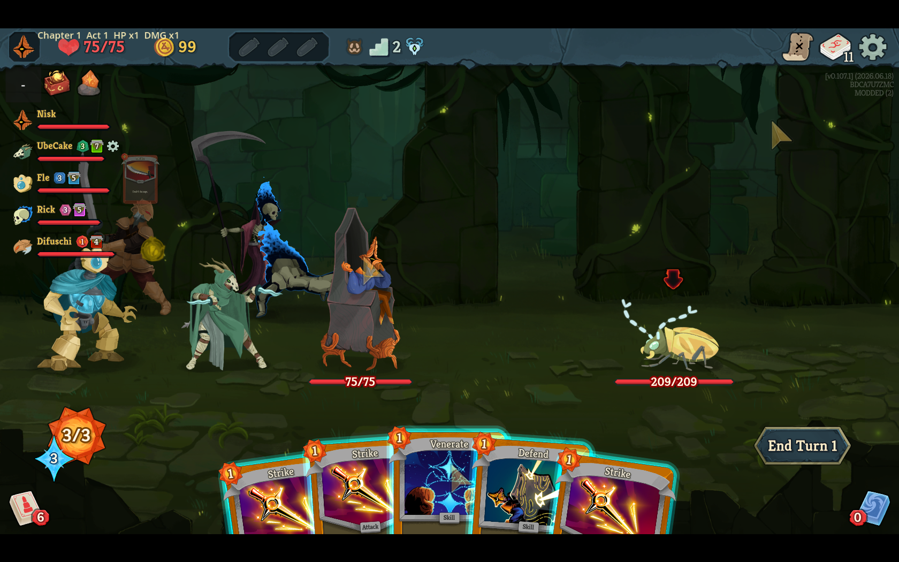
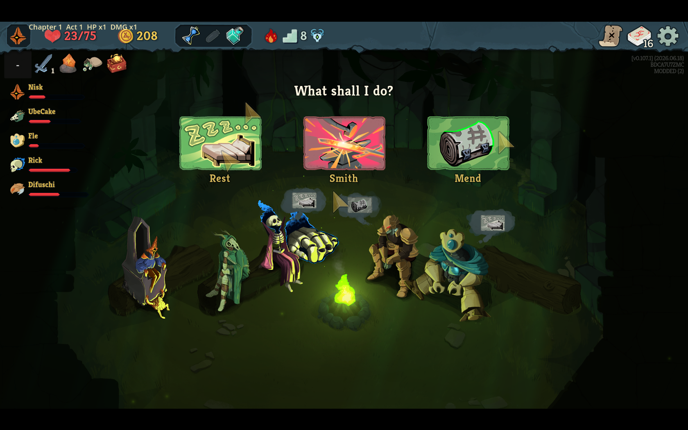

<div align="center">

# IncreasePlayerLimit

[**Changelog**](docu/Changelog.md)


*A Slay the Spire 2 multiplayer mod that lifts the vanilla 4-player lobby cap. Gather your party and climb the Spire together!*

</div>

**IncreasePlayerLimit** expands the cooperative multiplayer capacity in Slay the Spire 2. By default, it seamlessly supports **8 players** and can be configured up to **16 players** directly from the in-game settings screen.

<br>

<div align="center">
  
  <br><br>
  
  <br><br>
  
  <br><br>
  
</div>

<br>

## ✨ Core Features

* 👥 **Expanded Multiplayer:** Increases the maximum lobby size up to 16 players (default is 8).
* 🏕️ **Expanded Campfire Seating:** Player character models no longer overlap when more than 4 players are present. Campfires generate front and back rows complete with additional background seating logs.
* 💰 **Organized Shop Layout:** Visiting the merchant with a large group automatically arranges player models into neat multi-row grids to prevent crowding and clipping.
* 🎁 **Adaptive Treasure Room:** The relic selection screen scales dynamically, splitting relic holders into centered rows and providing a dedicated "Skip" relic button. Safeguards against empty pool crashes by falling back to Strawberry.
* 📝 **In-Game Settings:** Configure the maximum player count (4–16) directly in the General Settings menu.
* ⚔️ **Dynamic Difficulty Scaling:** When enabled, monster HP and block continue to scale beyond the vanilla 4-player cap using the game's official formulas to maintain challenge.
* 🔒 **Cross-Platform Compatibility:** Native support for Windows, macOS (with automated TLS handshake fixes), and Linux (automated dependency preloading).

## 🎮 Installation

### Windows

1. Download the latest `IncreasePlayerLimit-v[version].zip` from the **Releases** page.
2. Extract the archive and copy the inner `IncreasePlayerLimit` folder into your game directory: `<Slay the Spire 2>/mods/`.
3. Launch the game. The mod will load automatically.

### macOS (Apple Silicon)

macOS requires placing the mod inside the `.app` bundle and launching under Rosetta 2.

1. Download `IncreasePlayerLimit-v[version].zip`.
2. Extract the archive and place the `IncreasePlayerLimit` folder inside:
   ```
   <Slay the Spire 2>/SlayTheSpire2.app/Contents/MacOS/mods/
   ```
3. To bypass Steam initialization errors when launching directly, create a `steam_appid.txt` file next to the game executable with Steam running:
   ```bash
   echo "2868840" > "$HOME/Library/Application Support/Steam/steamapps/common/Slay the Spire 2/SlayTheSpire2.app/Contents/MacOS/steam_appid.txt"
   ```
4. Run the game under Rosetta 2 (right-click `SlayTheSpire2.app` > **Get Info** > check **"Open using Rosetta"**).

### Linux (Steam Deck / Desktop)

1. Download `IncreasePlayerLimit-v[version].zip`.
2. Extract and copy the `IncreasePlayerLimit` folder into:
   ```
   <Slay the Spire 2>/mods/
   ```
3. Launch the game via Steam. Native dependencies (`libgcc-s1`, `libstdc++6`, `libunwind8`) are handled automatically.

> **Note:** All players in the party must install the mod. Local preferences can differ; the host's configured limit governs the active lobby capacity.

## ⚙️ Configuration

Settings can be changed in-game under **Settings > General** or by editing `mods/IncreasePlayerLimit/config.ini`:

```ini
[macos]
tls_workaround=true

[multiplayer]
max_player_limit=8
difficulty_scaling=true
```

## 🛠️ Building from Source

Prerequisites:
- [.NET 9.0 SDK](https://dotnet.microsoft.com/download)
- [Godot 4.5.1 .NET](https://godotengine.org/)
- Slay the Spire 2 (v0.107.1+)

```bash
# Clone the repository
git clone https://github.com/0xb01/STS2-IncreasePlayerLimit.git
cd STS2-IncreasePlayerLimit

# Build release package
pwsh ./tools/build_release.ps1
```
The output package will be generated under `build/IncreasePlayerLimit-v0.1.3.zip`.

## 📜 License

This project is licensed under [CC0 1.0 Universal](LICENSE).
