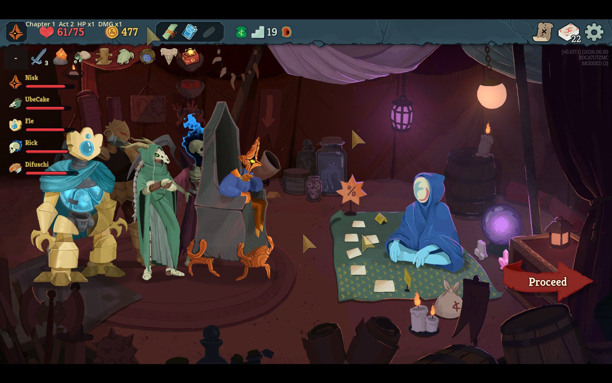
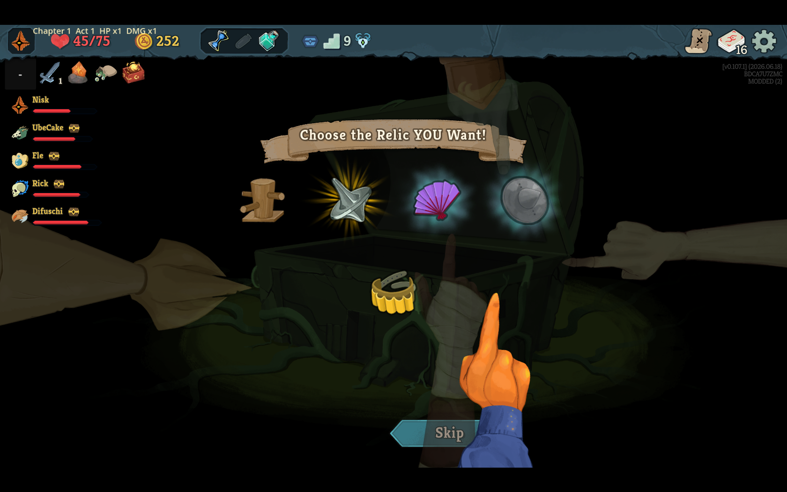

<div align="center">

# IncreasePlayerLimit

[**Changelog**](docu/Changelog.md)


Play Slay the Spire 2 multiplayer with up to 16 players! Default is 8 players.

</div>

<br>

<div align="center">
  
  <br><br>
  
  <br><br>
  
  <br><br>
  
</div>

<br>

## Features

- **More Players:** Play with up to 16 players (default 8).
- **Better Room Layouts:**
  - **Campfire:** Characters sit in two neat rows with extra logs.
  - **Shop:** Characters stand in clean rows so nobody overlaps.
  - **Treasure Room:** Relics display in neat rows, includes a "Skip" button, and gives Strawberry if relics run out.
- **Difficulty Scaling:** Monster HP and block scale for 5+ players (can turn off in settings).
- **In-Game Settings:** Change player limit (4-16) and difficulty directly in the game settings menu.
- **Works on All Platforms:** Windows, macOS, and Linux (Steam Deck).

> **Important:** Everyone in the lobby must install this mod. The host's settings decide the player limit.

## Installation

### Windows

1. Download `IncreasePlayerLimit-v[version]-Windows.zip` from [**Releases**](../../releases).
2. Unzip the file.
3. Run `Install.bat`.
   - *Or manually:* Copy the `IncreasePlayerLimit` folder into your `<Slay the Spire 2>/mods/` folder.
4. Start the game.

### macOS (Apple Silicon)

1. Download `IncreasePlayerLimit-v[version]-macOS.zip` from [**Releases**](../../releases).
2. Unzip the file.
3. Double-click `Install.command` (or run `./install.sh` in Terminal).
   - *Or manually:* Copy `IncreasePlayerLimit` folder into:
     `<Slay the Spire 2>/SlayTheSpire2.app/Contents/MacOS/mods/`
     and make a file named `steam_appid.txt` with text `2868840` in `<Slay the Spire 2>/SlayTheSpire2.app/Contents/MacOS/`.
4. Open the game with Rosetta 2 (Right click `SlayTheSpire2.app` > **Get Info** > check **"Open using Rosetta"**).

### Linux / Steam Deck

1. Download `IncreasePlayerLimit-v[version]-Linux.zip` from [**Releases**](../../releases).
2. Unzip the file.
3. Run `./install.sh` in Terminal.
   - *Or manually:* Copy `IncreasePlayerLimit` folder into your `<Slay the Spire 2>/mods/` folder.
4. Start the game from Steam.

## Settings

Change settings in-game under **Settings > General**, or edit `mods/IncreasePlayerLimit/config.ini`:

```ini
[macos]
tls_workaround=true

[multiplayer]
max_player_limit=8
difficulty_scaling=true
```

## Build from Source

Requirements:
- [.NET 9.0 SDK](https://dotnet.microsoft.com/download)
- [Godot 4.5.1 .NET](https://godotengine.org/)
- Slay the Spire 2 (v0.111.1+)

```bash
git clone https://github.com/0xb01/STS2-IncreasePlayerLimit.git
cd STS2-IncreasePlayerLimit

# Windows:
pwsh ./tools/build_release.ps1

# Linux / macOS:
./tools/build_release.sh
```

Built zip files will be in the `build/` folder.

## License

[CC0 1.0 Universal](LICENSE)
